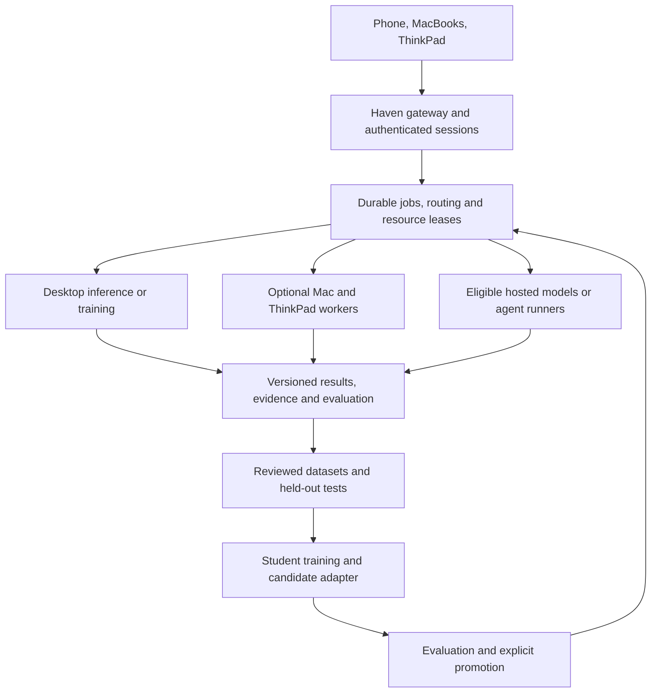

# Haven — Headless Compute, Comparison, and Learning Plan

Version 1.0 · 25 October 2026 · America/New_York

Status: implementation-ready design packet. Desktop conversion, new worker enrollment, provider calls, corpus import and model training have NOT been executed by this packet.

Repository: erpzz/haven. Inspected main: 4a73a55bfc263d53b8e657403a693004e2871ef6.

## 1. The decision

Use the existing desktop as Haven's primary inference and training server. Keep a thin Haven coordinator, durable job queue, independent model backends, and a versioned evidence store. Enroll each MacBook and the ThinkPad as optional, independently scheduled workers. Add one prompt corpus and two separate comparison lanes, then train small local students from reviewed examples.

The desktop remains Windows 11. Preserve the qualified native Windows inference path. An isolated training environment may use native Windows or the existing WSL installation after checking exact library support. Do not reinstall the OS or migrate ASTRA M0 to implement this plan.

Default engineering model: GPT-6.1 Sol Max. Astra is an optional architectural or result-review pass, especially when evidence conflicts; switching models is not a prerequisite. These are recommendations, not a claim that Astra has reviewed this packet. OpenAI's current documentation recommends Sol for complex coding/agentic work and describes Astra as its most capable option [S01].

This extends Haven's intelligence work. Daily assistance, independent two-user privacy, RF/spatial research, wearables, robotics, drones, emergency support and engineering/fabrication remain in scope. No physical capability is deployed by this compute plan. ASTRA M0, its M4 advisory baseline, and NIGHT-01 retain separate ownership.

## 2. What already exists

| Component | Evidence observed on 25 October | What remains |
|---|---|---|
| Windows Model Lab | Present on main; PR #25 merged, with later changes from PR #26 | New headless lifecycle and present-day requalification |
| Small-model CUDA and Strata paths | PC_QUALIFICATION_v2.md records real Windows execution and bounded synthetic checks | Current machine state and stronger-task results |
| Trusted-home LAN accounts | Model Lab README documents invite-only LAN mode and loopback backends | Durable server startup, encrypted remote access and worker identity |
| Comparison harness | PR #28 open; branch db93c5f... contains intelligence-bakeoff | Integration/review, current provider adapters, broader cases and actual runs |
| Bakeoff hardening | Separate review branch 495583a... exists | Inspect its diff before integration; existence is not acceptance |
| Distillation pipeline | PR #29 open at 2073c4d...; data construction and opt-in SFT/GKD scripts exist | Actual teacher data, GPU training, meaningful holdouts and promotion |
| Mac/ThinkPad workers | Supported as design targets in this packet | Inventory, enrollment, independent endpoint tests |

The older root CURRENT_STATUS.md is a dated coordination baseline, not a live runtime report. Conversely, the PC qualification report is historical evidence, not proof that its processes are running today. Full source/requirement migration remains incomplete: baseline/cumulative-v1.0/scope/COVERAGE.md is absent at the inspected main commit. This packet neither reconstructs missing originals nor claims a complete REQ/AT/EX crosswalk.

## 3. Architecture

The returning arrow means a qualified candidate can be registered as a backend. It does not authorize automatic self-modification, policy changes or deployment.

### Node roles

| Node | Initial assignment | Resource rule |
|---|---|---|
| Desktop: Ryzen 9 3900X, RTX 2070 Super 8 GB, 64 GB RAM | Main large-model inference; sequential teacher generation; student adapter training | One heavy GPU workload at a time |
| Known MacBook Air M4, reported 16 GB | Optional compact MLX model, independent comparison, light inference while desktop trains | Measure sustained speed and memory; fanless sustained performance matters |
| Other MacBooks, if enrolled | Roles chosen from measured hardware and supported runtimes | Do not infer count, chip or RAM |
| ThinkPad T16, reported i7/Iris Xe, approximately 24–32 GB | CPU validation, indexing, dataset preparation and optional small-model inference | Confirm memory and exact CPU before choosing a model |
| Hosted endpoints | DeepSeek plus configured OpenAI/other providers; bounded agent workers | Privacy eligibility, authenticated access, explicit spend limits |

This is task-level federation. The devices do not become one 100+ GB GPU, and their memories are not simply additive. Cross-platform tensor parallelism over ordinary home networking is excluded from the initial design. A worker receives a complete, scoped job; it does not receive the household credential store.

Apple's MLX LM supports generation and model fine-tuning on Apple silicon [S05]. That establishes a software route, not qualification of this particular Mac or every model architecture.

## 4. Implementation structure

Extend the existing Model Lab and R02 work rather than creating another assistant framework:

- labs/model-lab: existing launcher, engine management, UI and authentication.
- labs/intelligence-bakeoff: existing comparison/runtime experiment, integrated from reviewed PR #28.
- labs/intelligence-bakeoff/distillation: existing candidate pipeline from PR #29.
- New headless supervisor, node registry and shared case/run store: scoped modules added during HS-01 implementation, with exact paths chosen after inspecting the current code. Do not claim these modules already exist.

Keep ordinary deterministic work outside model calls. Use an adapter interface for models and a separate runner interface for agents. Hermes remains an optional measured runner from the existing experiment, not the mandatory control plane. No new eve/Hermes/OpenClaw migration is required.

OpenAI's current Sol tool-calling route is Responses; local backends and DeepSeek may use other documented dialects [S02, S06]. A common internal contract must not assume every provider accepts an identical HTTP request.

## 5. Headless desktop operations

Headless means inference and jobs continue without an open browser, monitor or remote-desktop session. It does not mean disabling Windows security or promising extra GPU capacity.

Implement in two observable stages:

1. Reuse the existing owned launchers and NoBrowser path. Verify authenticated start/status/cancel/unload/stop from a laptop, then lock Windows and disconnect the interactive client. The same controlled job must continue, and its result must remain retrievable.
2. Add a supervised startup mechanism under a suitable non-administrator identity, using a supported Windows service or scheduled task. Validate boot, ownership, model paths, secrets availability, readiness and shutdown before calling it unattended.

The exact startup choice depends on whether existing Windows Job Object containment and controller assumptions work in that identity. Do not replace them with process-name-wide termination. Do not enable automatic Windows login. A preboot PIN, user-scoped key access or other observed boot dependency is a real blocker to unattended boot, not something to bypass.

Required controls:

- Stable local storage paths, dependency/model pins and verified reuse of existing weights.
- Desired state separate from observed readiness; a running process is not model readiness.
- Persistent queued-job records and bounded retry/backoff. No repeated heavy restart loop after OOM or corrupt input.
- Retain useful partial answers and distinguish natural completion, output limit, cancellation, failure and unknown outcome.
- Clean shutdown, exact owned-process cleanup, log rotation, backup/restore and model rollback.
- If a sleep policy prevents serving, record and apply a narrowly scoped operator-approved change during host installation. Nothing in this documentation changes a power plan, driver, pagefile or firmware.

Use the current qualified 4K/2 GiB requested-reserve Strata profile as the recovery baseline. Qualification recorded about 6414 MiB device VRAM there. The requested reserve is not a guaranteed free-memory floor.

## 6. Network and identity

Model backends stay on loopback. Clients reach the authenticated Haven gateway; workers accept only enrolled, scoped job credentials.

The existing LAN mode is documented as trusted-home HTTP, not TLS or internet-ready. Retain it only within that established scope. Add an authenticated encrypted front door for the server deployment, with device enrollment and certificate trust tested on Mac, Windows and phone. If using a tunnel, use a reviewed authenticated configuration; never expose unauthenticated model ports or silently port-forward the router.

Offsite access is a separate deployment gate. A new VPN, tunnel vendor, account or subscription is not selected or provisioned by this plan.

Each worker advertises its verified identity, runtime/model revision, capabilities, available memory, current load and heartbeat. Enrollment can be revoked. A laptop that sleeps or leaves the network becomes unavailable; its memory is never counted as guaranteed capacity.

Each principal has separate sessions, retrieval scopes, private records and training eligibility. Shared household data is a third explicit scope. Kennedy's participation and sharing grants are independent; Eric's request does not supply her consent.

Inference caches must be partitioned by principal and model/prompt revision. If a backend cannot demonstrate safe partitioning, use isolated worker profiles/processes or clear private state on principal change. A user must not inherit another user's conversational state.

## 7. Routing and scheduling

Filter eligible nodes/providers by identity, data scope, modality, runtime compatibility and resource limits before optimizing quality, price or latency.

| Work | Initial route |
|---|---|
| Receipts, timers, arithmetic, schema checks, authorization | Ordinary deterministic code |
| Short extraction or ordinary conversation | Qualified compact model; Mac worker optional |
| Difficult synthesis, coding or larger evidence packet | Desktop Strata quality profile |
| Same-case comparison | Frozen evaluation runners; local runs serialized per heavy resource |
| Unit checks, parsing, indexing and dataset transforms | ThinkPad/CPU worker if available |
| Teacher dataset generation | Desktop or approved hosted teacher, in a bounded batch |
| Student training | Desktop exclusive GPU lease; large inference engine unloaded |
| GPU training underway | Queue heavy inference or route an eligible compact job to a laptop |

A model may propose a route; deterministic policy grants it. There is no silent cloud fallback for a local-only case. An optional worker disappearing cannot make protected operations fail open.

One resource lease covers the desktop GPU and host-memory envelope. Start with one heavy request; isolate interactive, heavy reasoning, evaluation and training queues. Prioritize cancellation/control/health checks over generation. Two users receive explicit queue positions and fair scheduling.

Use per-job deadlines, maximum steps, output/context bounds and retry counts. Record queue wait separately from inference time. Leases expire on heartbeat loss; reconcile possibly executed tool actions before any retry. Do not promise exactly-once external side effects from a queue.

Initial planning budgets: one heavy worker, at least 8 GiB available host RAM during a dedicated quality session, more for ordinary desktop use, and measured display/driver VRAM headroom. These are admission targets, not claims that IQ3_S plus every feature fits. Reject or downsize a job before persistent paging; record why.

## 8. Model profiles and optimization

Keep the existing Qwen3.5-4B Q4_K_M/official llama.cpp profile as the fast and recovery baseline.

Quality candidates for the large path:

| Flash-Next pack | Approximate expert RAM | Weight download | Role |
|---|---:|---:|---|
| IQ2_XS | 35.5 GB | 68.0 GB | Retained baseline |
| IQ3_XXS | 43 GB | 75.8 GB | First quality upgrade |
| IQ3_S | 50 GB | 83.6 GB | Dedicated quality session after fit measurement |

These are upstream planning figures, excluding operating-system/runtime needs. The large n-gram shard can remain sparsely accessed on SSD. Quantization benchmark results do not establish equal quality on every task [S03, S04].

Do not replace a known working engine in place. Qualify an updated pinned Strata build alongside the old one, one GPU process at a time. Compare Turing-specific kernels, CPU/PCIe scheduling, MTP versus expert-cache space, and context caching on the same task set. Keep numerical/behavior changes separate from scheduling-only changes. Do not multiply advertised speedups.

Begin heavy qualification at 8K or 16K context, then test 32K. The context budget includes prompt, generated reasoning and final answer. Longer windows need separate memory/accuracy evidence. User acceptance of latency permits slower work; it does not establish unlimited context.

Higher-precision SSD-backed packs are a later comparison, not a promised 8 GB configuration. DeepSeek V4.1-Flash's current Strata hardware path has different requirements and must not be declared supported on this Turing card from the Qwen result.

## 9. One corpus for historical prompts and new work

Import all available, deliberately selected prompt/attempt sources: repository prompts, saved work packets, user-supplied chat exports, and new Haven sessions. This is not a claim that the desktop can automatically read every historical ChatGPT conversation.

Preserve originals privately with source IDs, hashes and import dates. Never execute instructions merely because an old prompt contains them. Create normalized cases as separate derived records; retain failed attempts and corrections.

Every case records:

- case_id, version, task family and source references;
- principal, audience, privacy classification, permitted destinations and retention;
- ordered messages and context/attachment references with byte hashes;
- expected behavior, checks and tool/environment snapshot;
- train/evaluation split and training-use permission status;
- model-compatible modalities and whether any context is missing;
- original attempt IDs, correction lineage and duplicate/near-duplicate family.

Missing attachments or essential context produce BLOCKED_MISSING_CONTEXT. Do not silently invent them or compare incomplete and complete cases as equal.

All imports can be archived; only eligible records may be replayed remotely or exported for training. Historical employer/household-sensitive material remains local by default. Sanitized synthetic cases can enter the shared corpus. A partner-private example cannot become a shared student training example simply because it was useful.

## 10. Fair comparisons

### Lane A: models

Freeze task wording, supplied context, attachments, requested output format and evaluation criteria. Record each provider's exact rendered payload and unavoidable chat-template differences. Use a common supported context/output envelope, declared reasoning budget and comparable tool availability. Record token counts by provider; different tokenizers do not make equal token counts equal work.

Compare desktop/local models, Mac/ThinkPad candidates and eligible hosted models including DeepSeek. Record the resolved model/version when available; aliases can change. No paid call runs without configured credentials, eligible data and a finite spend reservation.

### Lane B: agents

Give each agent the same brief, repository/environment snapshot, tools, task scope, time/step/cost envelope and objective tests. Let its own supported harness operate, but record that harness. Do not compare a tool-using agent with a bare text model and attribute the entire difference to the model.

The existing R02 harness already separates runtime and model axes. Reuse it. Official CLI/subscription adapters may be used where supported and authenticated; consumer chat subscriptions do not automatically supply general API rights or training permissions. Never extract credentials from a browser session.

### Results

Store immutable run records with model/quant/runtime/template revisions, case/context hashes, node, tool calls/results, artifacts, final answer, finish reason, timestamps, queue/load/prefill/decode/wall times, retries, usage/cost and memory measurements. Unexposed reasoning, unknown energy and missing token counts remain unknown.

Use blinded answer labels, independent objective checks and human usefulness review. A model judge can supplement these; agreement among models is not evidence of truth. Count transport errors, invalid tool arguments and truncation. Preserve negative results.

## 11. Distillation curriculum

The objective is measured task improvement in small local students, not copying the entire capability of a frontier teacher. Separate knowledge learning, task skill, retrieval and instruction-following evaluations.

1. Generate teacher attempts using the large desktop model or an eligible hosted model.
2. Validate answers and tool outcomes. Select verified successes; retain failures in a review queue.
3. Produce reviewed corrections and prospective failure-avoidance targets without leaking the failed trajectory or answer into the target's input.
4. Build versioned datasets with completion/assistant-token masking and source-to-example lineage.
5. Train a candidate adapter in an exclusive resource window.
6. Re-evaluate base versus candidate on frozen holdouts; promote only a demonstrated improvement with rollback.

Do not train indiscriminately on every answer or on hidden provider chain-of-thought. Visible reasoning or a concise solution explanation is not guaranteed to be the actual internal computation. Prefer verified solution artifacts, tool traces and compact explanations.

### Training lanes

| Lane | Mechanism | Initial use |
|---|---|---|
| Offline teacher-answer SFT | Train from selected text/tool examples | Primary practical route on current desktop |
| Reviewed failure-aware SFT | Separate adapter for corrected prospective guidance | Preserve PR #29's evidence/review gates |
| Preference learning | Independently verified chosen/rejected pairs | Later controlled comparison against SFT |
| On-policy token distillation | Student-generated prefixes, teacher probabilities and an explicit loss | Later research lane after compatible teacher access and memory qualification |

A text-only teacher API is sufficient for response-based SFT, but not automatically sufficient for full token-distribution KL distillation. A few returned top-logprobs are not the full distribution. Cross-family tokenizers also complicate direct token losses; response-based SFT can still use their text.

PR #29 currently has an experimental local teacher/student GKD path, a 16 GB default memory gate and no remote-teacher logits adapter. Do not bypass that gate to label the 8 GB PC qualified. Current TRL has evolved its distillation APIs; pin and adapt deliberately rather than silently replacing the imported implementation [S07].

### Hardware-appropriate training progression

- First mechanics run: reuse PR #29's separate Qwen3-0.6B fp16 LoRA pilot. This is a training-path check, not the final capability target.
- First useful student candidate: approximately 1–2B parameters, with Qwen3-1.7B as a candidate after measuring memory. Use a compatible Hugging Face checkpoint, not the inference GGUF.
- A 3–4B student is a later, separately qualified target. Do not assume the existing Qwen3.5-4B model can be trained within 8 GB, or that every architecture tolerates the same low-bit recipe.
- Start with microbatch one, bounded sequences, gradient accumulation, checkpointing where supported, and fp16 on Turing. Quantization, activation offload and adapters require measured compatibility.
- The large Flash-Next model is an inference teacher; training it is not a target for this GPU.

Generate teacher data first, unload the large teacher, then train the student. An optional Mac teacher can serve independent small-model requests during training. A future remote logits server requires a real probability-scoring protocol, matching tokenizer/weights where necessary, and explicit tests; ordinary chat serving does not establish it.

Keep stable knowledge and personal records in attributed retrieval stores initially. Do not bake secrets, mutable account state or partner-private memories into shared weights. Version each dataset, base checkpoint, adapter and conversion. A PEFT adapter is not automatically usable by the GGUF server; use a supported HF serving path or a validated conversion tied to the exact base.

## 12. Evaluation and promotion

Use the existing synthetic fixtures as instrumentation checks. Add a proposed initial holdout suite of at least 60 task families: 20 coding/automation, 20 tool/retrieval workflows, and 20 extraction/grounding/uncertainty tasks. Include separate mandatory identity, cross-user isolation, cancellation and resource-failure tests. Freeze rubric, task families and splits before training.

Split by task family/source and deduplicate before splitting. Paraphrases of training examples do not become clean holdouts. Do not put every historical prompt into training and then report it as an independent test.

Compare base and adapter with paired runs, consistent tool/environment snapshots and multiple sampling seeds where supported. Report per-family pass rates, paired uncertainty intervals, first-attempt versus repaired success, wall time and cost per verified success. Teacher and judge identities are recorded. Self-reported confidence is not a quality metric.

Promote only when the predeclared primary task metric improves repeatably, critical isolation/action tests pass, other declared tasks do not materially regress, and resource cost is acceptable. If uncertainty still includes no improvement, retain the base and label the candidate inconclusive. A lower training loss or completion of training is not sufficient.

## 13. Delivery sequence

| Package | Deliverable and stop gate |
|---|---|
| HS-01/P0 | Inventory current checkout, processes, free storage, available memory and authentication; reconcile PR #28/#29 locally; retain backups and a dependency ledger |
| HS-01/P1 | Headless primary node, persistent jobs and authenticated client access; lock/disconnect and reboot/recovery acceptance |
| HS-01/P2 | Versioned case/run store, import preview and model/agent comparison lanes; same-case local/DeepSeek comparison when credentials and spend are configured |
| HS-01/P3 | Optional Mac and ThinkPad enrollment; offline-node, revocation, resource-routing and desktop-training contention tests |
| HS-01/P4 | Curated teacher dataset, small LoRA run, base/adapter evaluation and reversible candidate serving |
| HS-01/P5 | Larger student, preference learning or remote-teacher on-policy experiment only when earlier evidence justifies it |

P0–P4 are the implementation sequence, not claims of current completion. Each package returns code, exact configuration and observed results. Do not replace implementation with endless new literature scans, but do not report a missing host or credential as a completed run.

The included IMPLEMENTATION_HANDOFF.md is the next desktop-local assignment. This planning session does not install services, change firewall/power policy, import private conversations, make paid calls or execute training.

## 14. Failure behavior

- WAN unavailable: local jobs continue; hosted-only work reports unavailable.
- Optional laptop asleep: stop assigning it; reconcile its leased jobs.
- Desktop GPU busy or OOM: reject/requeue with evidence; keep control/receipt services responsive.
- Provider budget exhausted: stop new metered requests; no hidden provider switch.
- Crash during generation: retain partial output and truthful state; do not call it completed.
- Crash during training: keep the last valid checkpoint/receipt; preserve current champion.
- Revoked data grant: block new retrieval/export and cancel affected queued work; inspect derived datasets/caches.
- Unknown external tool outcome: reconcile before retry, rather than duplicate a side effect.

## 15. Source register and open facts

Checked 25 October 2026 unless a repository pin is specified. These are sources, not installation instructions.

- S01: [OpenAI model selection](https://learn.chatgpt.com/docs/models).
- S02: [GPT-6.1 Sol API model](https://developers.openai.com/api/docs/models/gpt-6.1-sol).
- S03: [Strata model memory guide](https://github.com/Niko1221/Strata/blob/main/docs/MODELS.md).
- S04: [ISTA-DASLab Flash-Next quantization card](https://huggingface.co/ISTA-DASLab/Qwen3.8-Flash-Next-GSQ-RCO-GGUF).
- S05: [Apple MLX LM](https://github.com/ml-explore/mlx-lm).
- S06: [DeepSeek API documentation](https://api-docs.deepseek.com/).
- S07: [TRL distillation](https://huggingface.co/docs/trl/distillation_trainer) and [SFT](https://huggingface.co/docs/trl/sft_trainer).
- Main evidence: [PC qualification](https://github.com/erpzz/haven/blob/4a73a55bfc263d53b8e657403a693004e2871ef6/labs/model-lab/docs/PC_QUALIFICATION_v2.md), Model Lab README, root instructions/protocol and original intelligence chapter at the same commit.
- PR #28 source: db93c5f857550b7f8104e41bba1b7167fd3327e7; review branch 495583a1782e4d97d0e30b18c939929c2c4c8cde.
- PR #29 source: 2073c4d912af6f8c43554440863c28eacad2db7b.

Open facts to measure during P0: present disk free space and SSD performance, current RAM/VRAM headroom, exact laptop inventories, current local checkout/runtime state, boot/key dependencies, enrolled client trust, eligible hosted credentials/budget and the selected historical exports. None blocks finalizing the architecture; they do constrain actual deployment.

No shared contract, canonical decision register, original requirement ID or preserved source is rewritten by this packet. Its local interfaces remain proposals until implemented/reviewed in the scoped continuation.
