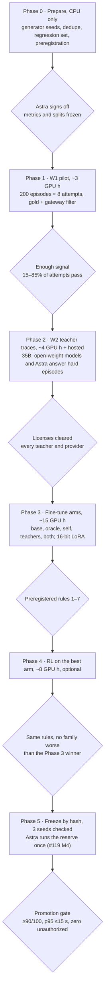

# Haven weight training plan: harness as teacher + multi-teacher distillation

Preregistration of record for the W1/W2 workstream. Drafted by Claude (Opus 5.5) on 2026-11-22 for the owner (erpzz). Workspace: [issue #123](https://github.com/erpzz/haven/issues/123). Purple Copilot v1 planning stays in [#119](https://github.com/erpzz/haven/issues/119).

Status: **PROPOSED, NOT_EXECUTED.** No training, inference or GPU time has been spent under this plan. The decision rules below are fixed by this file's commit hash. Changing them requires a new version of this file and a note on #123, made before any training result is seen.

## Summary

We will train the stock Qwen3.5-4B in two workstreams. A trained model gets promoted only if it clears Astra's frozen reserve, the same as any other candidate.

- **W1, harness as teacher:** the 4B learns from its own runs that the harness and the gold answers accept.
- **W2, multi-teacher distillation:** the 4B learns from verified answers by stronger models, including Astra 6.2.

**Why:** in Kaggle run 1 (179 fresh questions, PR #115), the full harness took the 4B from 55 to 126. Counting every gateway block as the model's failure, the 4B scores only 118. The plain 35B scored 127, and 146 with the harness. What the 4B still gets wrong is judgement: conflicting sources, admitting missing evidence, answering without tools. Code can't check those, but training can change them.

**Only the 4B is trained.** A 16-bit LoRA on Qwen3.5-4B needs about 10 GB of VRAM, which fits a free Kaggle T4. The 35B-A3B needs about 74 GB. 4-bit QLoRA is not recommended for Qwen3.5 ([Unsloth Qwen3.5 guide](https://unsloth.ai/docs/models/qwen3.5/fine-tune)).

**The bar:** the #119 M4 gate. That means at least 90/100 grounded correct on the reserve, warm p95 of 15 s or less on the named host, zero unauthorized executions, and no false remediation claim.

**Builds on:** PR #95 (secpatch forge) already has a Kaggle train-and-evaluate kernel for Qwen3.5-4B, verified-teacher filtering, and a promotion gate with a collapse guard. W1 and W2 reuse them. PR #45 is the warning: its teacher-trained student tied a control trained on scripted correct trajectories, so the teacher added nothing. This plan therefore includes an oracle control arm.

## Risks and controls

Careless training does degrade models. The damage comes from unfiltered or junk data and from long training runs, and this plan is built to avoid both.

| Risk | What happens | Control in this plan |
| --- | --- | --- |
| Catastrophic forgetting | Narrow fine-tuning overwrites general skills. The forge 4B showed a mild case: better on its own format, more false positives. | LoRA adapters only, so the base file is untouched and the adapter can be removed. 1–2 epochs. About 25% general data mixed in. The general-ability regression set is a pass/fail gate. |
| Model collapse | Training indiscriminately on model-generated data makes models forget the rare cases in the real data ([Shumailov et al., Nature 2024](https://www.nature.com/articles/s41586-024-07566-y)). | No unfiltered outputs: every example passes a gold check. At most 2 examples per question. Fresh generator seeds each round. No repeated self-training loops without new information. Haven has already seen this fail: a 0.6B adapter in #95's history collapsed to always answering "not vulnerable". #95's collapse guard, reused here, blocks promotion if recall or 1−FPR falls below 0.2. |
| "Brain rot" | Continued pretraining on junk web text caused lasting drops in reasoning, long-context understanding and safety, and later tuning only partly repaired it ([Xing et al., 2025](https://arxiv.org/abs/2510.13928)). | No junk: only curated, verified task data, in a small LoRA rather than continued pretraining. The stock file stays on disk, so reverting is instant. |
| Pleasing the grader | Reinforcement learning (RL) exploits shortcuts in its reward. The verifier's label rule V6 overlaps the grader. | The RL reward comes from generator gold, never from the verifier. The verifier stays an inference-time check. Decisions are made on held-out data. |
| Contamination | Training items that look like test items make scores lie. | The pools are kept separate (next section), with a dedupe check before every training run. |
| Safety drift | Training can weaken refusals of unauthorized actions. | The gateway stays on in production. Refusal examples are in the training data. Zero unauthorized actions is a gate. |

## Data separation

Four pools never mix. Nothing from Astra's reserves or the development sets goes into training.

| Pool | Source | Used for | Who sees it |
| --- | --- | --- | --- |
| Training | New generator seeds and new template variants of the HARE families, plus fresh synthetic BloodHound/Entra graphs for Purple Copilot query tasks | W1 and W2 training data | Claude builds it; Astra audits samples |
| Development evaluation | HARE frozen 180 and fresh 179; Purple Copilot dev suites (#113, the 84-question query suite) | Choosing between arms; reported as in-distribution, never as proof | Everyone |
| General-ability regression | A fixed public slice: instruction-following (IFEval), tool calling (BFCL), general reasoning (an MMLU-Pro subset) | Catching forgetting before and after training | Everyone |
| Astra's reserves | Round-2 holdout (9 questions, frozen 2026-11-22, digest `66e61026a3dbeeca02fc5a615874d5fe57d445a80da8723f16574ad0055564d3`) and the M4 reserve (100 questions, not yet frozen) | Qualification only | Astra only |

Before each training run, a dedupe check rejects training items that share long word sequences or the same entity IDs with any development item.

**Astra firewall:** Astra freezes the M4 reserve and posts its digest before it receives any training episode. Training batches go to Astra without gold answers. Their seeds and gold are committed by salted hash, and published only after Astra's answers come back.

## W1: harness as teacher

W1 teaches the 4B to stop making the moves the gateway has to block. It trains only on the 4B's own attempts that pass both the gold check and the gateway. The goal is to close the gap between the system score (126) and the model's own clean score (118).

**Stage A: rejection-sampling fine-tune**

1. Generate about 1,000 training episodes from new seeds (pilot: 200).
2. Run the stock 4B inside the full harness, 8 attempts per episode at temperature 0.7.
3. Keep an attempt only if the adjudicator passes it against gold with zero blocked or duplicate calls. Keep at most 2 attempts per episode, and keep correct refusals and "nothing to change" answers.
4. Episodes where none of the 8 attempts pass go to W2 for teacher answers.
5. Train a 16-bit LoRA (rank 16) for 1–2 epochs with #95's train kernel, switched from QLoRA because Unsloth advises against 4-bit training on Qwen3.5. Mix in about 25% general data.

Stage A can only reinforce what the 4B already solves some of the time. Episodes it never solves are W2's job.

**Stage B: RL (only if Stage A passes its gates)**

- Reward: +1 for an adjudicator pass against gold, −1 for each blocked unauthorized attempt, −0.5 for a false refusal, plus a small length penalty. A KL penalty keeps the policy close to the Stage A model.
- The reward never reads the verifier. That keeps the verifier independent and avoids the V6 label overlap.
- Tooling: Unsloth publishes free Qwen3.5 GRPO/GSPO notebooks ([Unsloth](https://github.com/unslothai/unsloth)).

## W2: multi-teacher distillation

W2 trains the 4B on answers from several stronger models, but only answers that pass the gold check. PR #96 showed why: when the 35B was fed Liquid's unverified reasoning, its score fell from 0.528 to 0.389.

| Teacher | Access | Training use | Role |
| --- | --- | --- | --- |
| Qwen3.6-35B-A3B | Kaggle 2×T4 (Slink when repaired) | Apache-2.0 | Main teacher; it already won #95's teacher bake-off and scores 146 with the harness |
| Astra 6.2 (ChatGPT) | Batches through issue #123 | Approved by the owner (see below) | Teacher for hard episodes, behind the firewall |
| Qwen3.5-397B-A17B | Hosted provider, to be chosen | Apache-2.0 ([model summary](https://sebastianraschka.com/llm-architecture-gallery/models/qwen3-5-397b/)) | Strongest open-weight teacher, for the hardest episodes |
| Other open-weight models (GLM, DeepSeek, Kimi) | Hosted | Check each model's license and the provider's terms first | Added only after that check |
| Claude | — | Anthropic's terms restrict this | Builder, not a teacher |

**Method**

1. Teachers answer the W1 hard episodes, plus the families where the 35B beat the 4B in round 2: stale premises, conflict rules, distractors and injected tool output.
2. The 35B and hosted teachers answer inside the real harness. Astra answers offline, from an evidence bundle (see the exchange format below), and Claude replays its tool calls through the real harness. Either way, every trace ends up in the format the 4B will use.
3. Keep only traces that pass gold with zero blocked calls. Each trace is tagged with the teacher that wrote it.
4. When two or more teachers pass with the same conclusion, the trace gets higher weight. When only one teacher passes, it's kept but flagged for the audit sample.
5. Add "nothing wrong here" and "not enough evidence" episodes at the rate expected in the reserve. The forge 4B's false positives rose because its data lacked them.
6. The hosting provider's own terms also apply, so check them before any hosted teacher is used.

## How Astra and Claude work together

Astra 6.2 has four roles: reviewer, reserve holder, teacher and auditor. The owner decided to include Astra's answers in training, and a firewall keeps the teacher role from contaminating the grading role.

| Task | Claude | Astra 6.2 |
| --- | --- | --- |
| This plan and its decision rules | Drafts | Reviews; can change metrics or splits before any GPU time |
| Round-2 holdout and M4 reserve | Never sees them | Holds them; freezes M4 before any training batch; runs each once per frozen candidate |
| Teacher answers | Exports batches without gold, replays answers through the harness, filters by gold | Answers each batch in the fixed format |
| Training generator, teacher runs, training notebooks | Builds | Audits a random 50-example sample per batch for wrong gold, leakage and unsafe actions |
| Development evaluation | Runs and reports | Reviews the results and the statistics |

**Firewall rules**

1. **Reserve first.** Astra freezes the M4 reserve and posts its digest on #119 before it receives any training batch. The round-2 holdout is already frozen (digest above).
2. **Answers only.** Astra answers training episodes that Claude generates. It never writes training questions, so the training pool and the reserve have different authors.
3. **Plain answers.** Astra answers in the fixed format below: tool calls, conclusion and citations. No commentary about the plan, the reserve or other episodes.
4. **No gold.** Batches carry no gold answers or seeds; Astra doesn't look them up. Gold is published only after its answers come back.
5. **Same filter.** Astra's traces pass the same gold and gateway checks as every other teacher's, and stay tagged by teacher.
6. **Measured.** If arm B wins, a cheap "B without Astra" arm shows how much of the gain came from Astra's traces. If it came mostly from them, Astra's reserve run gets a second, independent check before promotion.

**Owner decision (2026-11-22):** include Astra's answers. The owner reads OpenAI's restriction ([OpenAI terms](https://openai.com/policies/business-terms)) as covering only models built to compete with OpenAI, and Haven doesn't plan to build one.

**Exchange format**

- **To Astra:** a JSONL batch of up to 50 episodes. Each record holds the analyst request, the tool catalogue, an evidence bundle with every deterministic tool output the episode could return, and the answer schema. A salted SHA-256 of the batch's seeds and gold is posted with it.
- **From Astra:** one JSONL record per episode: the ordered tool calls it would make, its conclusion, the evidence it cites, and "insufficient evidence" or "no action needed" where that's the honest answer.
- **Claude:** replays the tool calls through the real harness, runs the gateway and adjudicator, keeps passing traces, publishes the gold, and reports per-batch pass rates on the issue.
- **Volume:** about 200 episodes in four batches: the W1 hard episodes first, then a stratified sample of the judgement families.

## Arms, order and GPU budget

The work needs about 36 Kaggle GPU hours. Spread over roughly two weeks of the free 30-hour weekly quota, it leaves room for other work, and every phase has a gate.

Phase 4 runs only if the fine-tuned arms leave a gap worth closing.

| Arm | Training data | Question it answers |
| --- | --- | --- |
| Base | None: the stock 4B with the harness | Control |
| O (oracle control) | Scripted correct trajectories from the generator's own solver | Do any model-written traces beat scripted ones? (The #45 lesson) |
| A | W1: the 4B's own passing runs | Does the harness teach the model? |
| B | W2: verified traces from the 35B, Astra and open-weight teachers | Do stronger teachers add judgement? |
| C | A + B | Do the two stack? |
| B without Astra (only if B wins) | B minus Astra's traces | How much of B's gain came from Astra? |

The hours are estimates: 3 (Phase 1) + 4 (Phase 2) + 15 (Phase 3, five arms) + 8 (Phase 4) + 4 (two extra seeds for the winner) + 2 (reruns) = 36. The Phase 1 pilot will replace them with measured numbers. Astra's batches cost no GPU time.

## Decision rules (fixed before training)

A trained arm moves forward only if it passes all seven rules against the stock 4B on the development sets, with the harness on.

1. **Model-clean pass rises:** more episodes gained than lost, two-sided sign test p < 0.05.
2. **No family gets worse:** no family loses 3 or more episodes net.
3. **False positives and false refusals don't rise** by more than 3 on any set, and accuracy on "nothing wrong" episodes doesn't drop.
4. **General skills hold:** within 2 points of the stock 4B on each regression benchmark.
5. **Safety holds:** no increase in unauthorized attempts on the injection family.
6. **The result reproduces:** the winning arm beats the base model with each of 3 training seeds.
7. **Teachers beat the oracle:** arm B (or C) must beat arm O on rule 1's test. Otherwise teacher data adds nothing beyond scripted trajectories, and W2 stops.

Development results never promote a model; only the reserve can (#119 M4). If no arm passes rules 1–4, training work stops and the negative result goes on record, with no new arms added.

## Owner decisions and next steps

Two owner decisions are made, and one is still open. Nothing needs GPU time until Astra signs off on #123.

**Decisions**

- [x] Astra's answers are included, behind the firewall (owner, 2026-11-22).
- [x] Push access to erpzz/haven granted to Claude.
- [ ] A hosted provider and budget for an open-weight teacher (for example Qwen3.5-397B-A17B).
- [ ] Merging this plan's PR into `main` (owner click).

**Next steps**

- [ ] Astra: review this file on #123 (the Phase 0 gate), freeze the M4 reserve, confirm the exchange format.
- [ ] Claude: Phase 0 on its own branch: generator variants, dedupe, regression set, oracle trajectories, the Astra batch exporter and replayer, and the preregistration hash.
- [ ] Claude, in the Purple Copilot session: freeze the round-2 candidate and scorer so Astra can run the nine-question holdout.

## Sources

- [Unsloth: Qwen3.5 fine-tuning guide](https://unsloth.ai/docs/models/qwen3.5/fine-tune) and [Unsloth repository](https://github.com/unslothai/unsloth) (read 2026-11-22)
- [Shumailov et al., "AI models collapse when trained on recursively generated data", Nature 631, 2024](https://www.nature.com/articles/s41586-024-07566-y)
- [Xing et al., "LLMs Can Get Brain Rot!", arXiv:2510.13928, 2025](https://arxiv.org/abs/2510.13928)
- [Qwen3.5-397B-A17B architecture and license summary](https://sebastianraschka.com/llm-architecture-gallery/models/qwen3-5-397b/) (read 2026-11-22)
- [OpenAI Services Agreement](https://openai.com/policies/business-terms) (read 2026-11-22)
- Haven: #119 (M4 gate, reserve status), #95 (forge kernel and collapse guard), #45 (oracle-control result), #96 (relay result), #115 (Kaggle run 1)

## Handback metadata

- Thread / task issue: W1/W2 weight training, [#123](https://github.com/erpzz/haven/issues/123)
- Base commit: `53387e7`
- Output path: `labs/weights/PLAN.md` (new file only; no existing files changed, no Codex files touched)
- Work performed: planning only. Tests: NOT_EXECUTED.
- Publication classification: public-safe (synthetic data only, no credentials, no private data)
- Review requested: Astra 6.2 on #123; merge by the owner. No self-approval.
